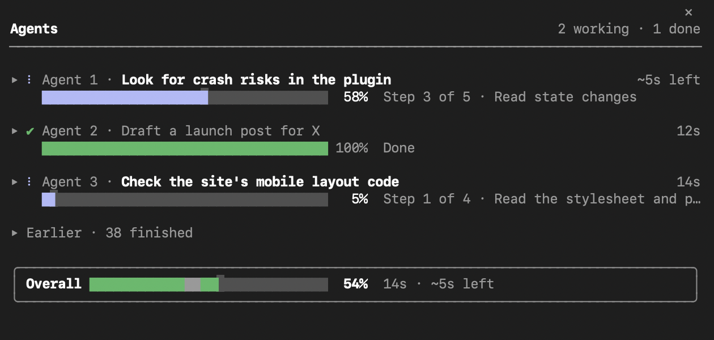

# Agent Progress

**See what your Claude Code agents are doing.** When Claude splits work across helper agents, you get a live progress bar for each one: what it's working on in plain words, how far along it is, and how long is left.



## Install

Inside Claude Code, type:

```
/plugin install agent-progress --marketplace ishmael07/agent-progress
```

Claude Code asks whether to add `ishmael07/agent-progress` as a marketplace (the place the plugin is downloaded from). Press `y`, then press Enter to install it for your user, so it works in every project. The bars show up the next time Claude runs agents. If they don't, restart Claude Code.

From a shell instead:

```
claude plugin install agent-progress --marketplace ishmael07/agent-progress
```

In the Claude desktop app: click **+** next to the prompt box, then **Plugins**, **Add marketplace** with `ishmael07/agent-progress`, then **Add plugin**.

New to Claude Code? The [setup guide](https://ishmael07.github.io/agent-progress/setup.html) walks through everything from scratch.

## What you get

- **A labelled bar for each agent, above the prompt.** Each one says which agent it is (its name, or Agent 1, Agent 2…), what it was asked to do, the step it's on ("Step 2 of 4 · Run the tests"), % done and time left.
- **Plain words.** No tool names or file paths: "Reading the login code", not `Grep auth.ts`.
- **Click a row** to see how that agent helps with your request, plus its checklist.
- **`/progress`** shows the live bars right in the chat, even while Claude is busy, and opens a table with every agent, workflow agents grouped under their workflow, and an overall bar when more than one is running.
- **Timestamps.** Finished agents show when they finished, and earlier batches are grouped under the time they ran.
- **A short notice** when all agents are done.

## Commands

| Command | What it does |
| --- | --- |
| `/progress` | Show the live bars right in the chat and open the table on the side. Works even while Claude is busy. |
| `/progress explain` | Open every row at once (again to fold) |
| `/progress off` / `on` | Stop the bars from popping up on their own, or bring them back. Remembered across sessions. `/progress toggle` flips it. |
| `/progress clear` | Remove finished agents |

## Settings

Change these in `/config` under **agent-progress**.

| Setting | Default | What it does |
| --- | --- | --- |
| Ask agents for a step list | On | Adds a short note to each subagent's instructions asking it to share a plain step list and check it off. This is what makes the % accurate. |
| Plain-language summaries | On | When an agent doesn't say how it helps, Agent Progress writes one sentence about it using Claude Haiku. |
| Show bars above the prompt | On | The live bars above the prompt. The table works either way. |
| Notify when agents finish | Off | A system notification when all agents are done. |

## How it works

Claude Code doesn't report a % for agents, so Agent Progress works it out:

- **With a step list** (the default), each subagent gets a small `progress` tool and a short note asking it to share its plan and check steps off. The % follows the steps. Within a step the bar keeps moving at the agent's own pace, but never passes the next step's mark.
- **Without one**, the bar is an estimate from the agent's activity, marked with `~`.
- **Time left** appears after an agent finishes its first step, based on how long its steps take. Before that you see how long it has been running.

**Cost and privacy.** The step-list note adds a few tokens to each subagent. With summaries on, an agent that doesn't explain itself costs one small Claude Haiku call. That call includes your latest request and the start of that agent's instructions. It goes through your own Claude Code session, like any other request. Nothing is sent anywhere else. Turn either off in `/config`.

## Requirements

An up-to-date Claude Code (run `claude update`). Agent Progress uses plugin mods, a new early-access part of Claude Code, so a Claude Code update could change how it works. If something breaks, please open an issue.

## Update or uninstall

```
claude plugin update agent-progress      # then restart Claude Code
claude plugin uninstall agent-progress
```

## Develop

```
claude --plugin-dir .          # run it from this folder
claude plugin test .           # run the tests
claude plugin validate .       # check it
```

## License

MIT. Not made by or affiliated with Anthropic. Claude and Claude Code are trademarks of Anthropic.
